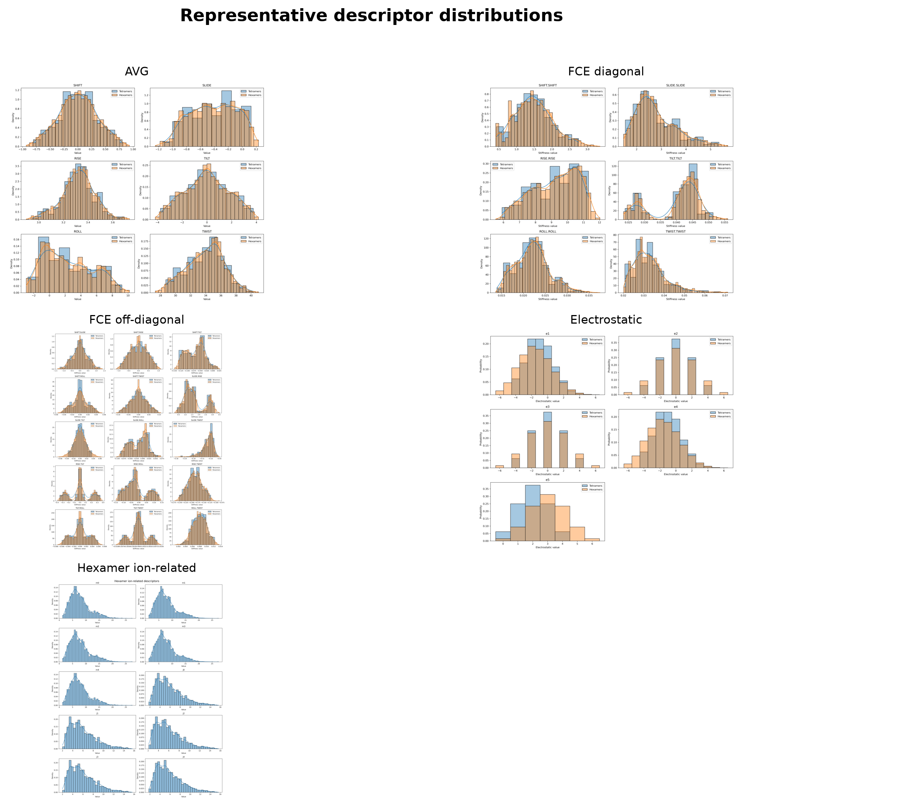
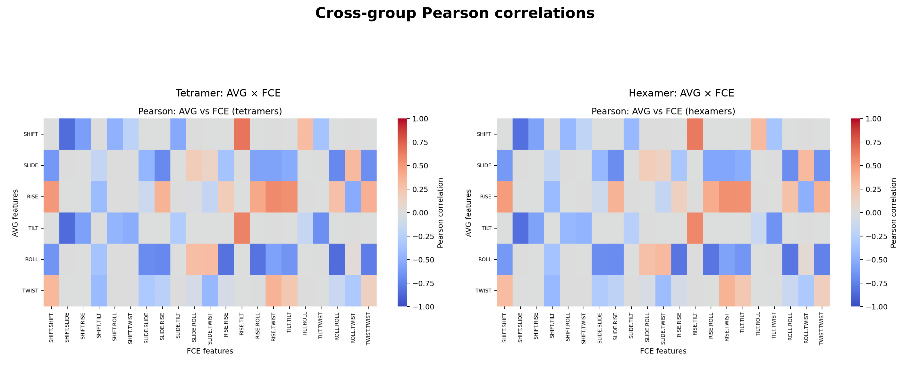
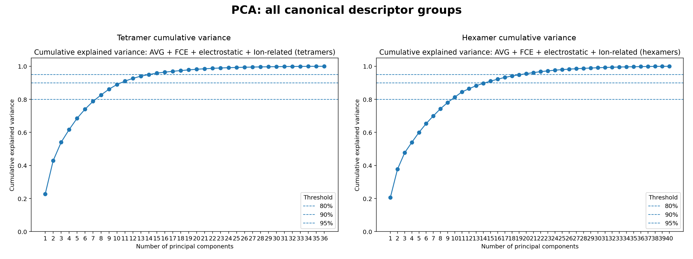
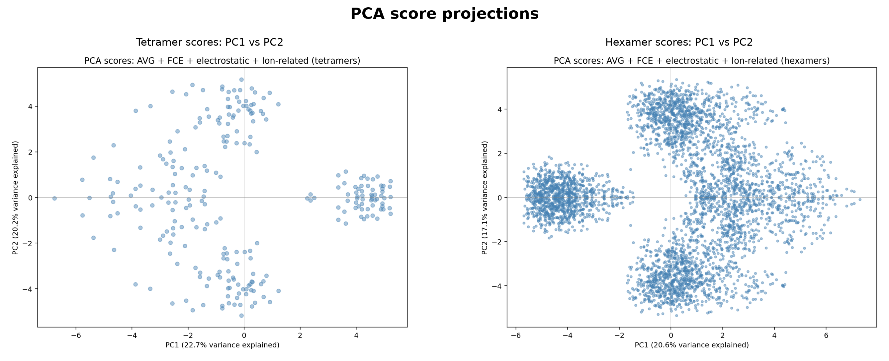
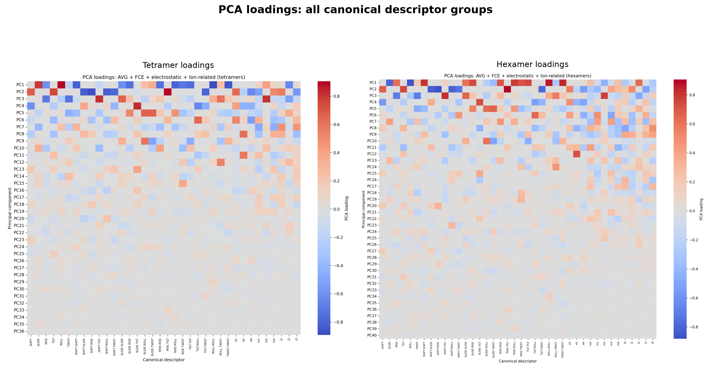
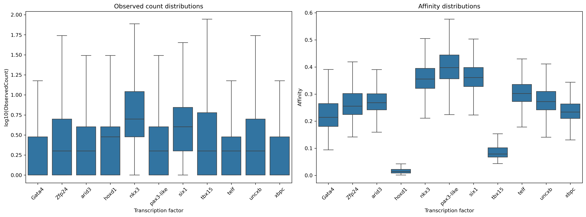
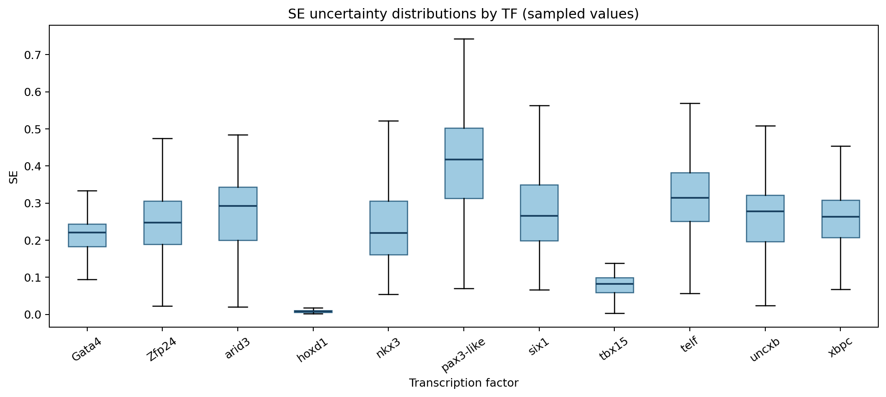
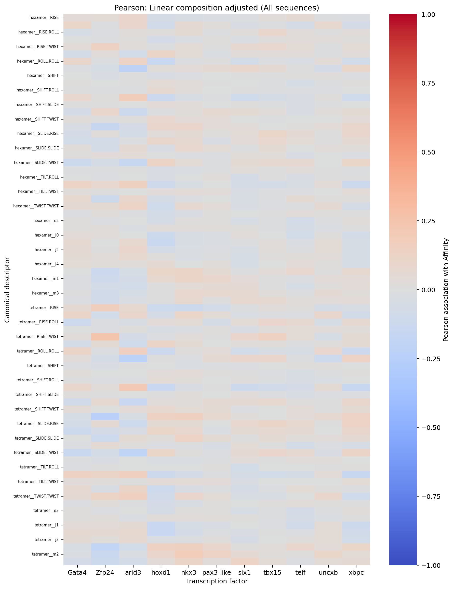

# DNA structural and physicochemical descriptors in HT-SELEX: an exploratory analysis
## Abstract
**Background.** DNA structural and physicochemical descriptors may capture sequence variation beyond simple nucleotide composition. We assembled an exploratory analysis of 10-mer HT-SELEX data for 11 transcription factors (TFs).
**Methods.** Canonical descriptor tables contained 36 tetramer and 40 hexamer features. Each 10-mer was mapped to seven overlapping tetramer and five hexamer windows, with values averaged within window length. We examined descriptor distributions, Pearson and Spearman correlations, standardized PCA, and associations with enrichment-derived Affinity before and after linear or quadratic composition adjustment. A prespecified sensitivity analysis retained ObservedCount ≥ 2.
**Results.** All 11 TF-cycle inputs passed sequence and target checks (5,444,696 10-mers). Typical linear-adjusted median absolute Pearson coefficients ranged from 0.014 to 0.045 across descriptor groups; directions varied across TFs. The degree-two composition basis improved in-sample Affinity R² for every TF (median change 0.021; range 0.005–0.130). The count filter excluded 1,709,738 sequences (31.4%); unfiltered-to-filtered direction agreement was 92.6% for Pearson and 90.4% for rank-residual Spearman.
**Conclusions.** Modest conditional associations remain under the specified composition models, but these analyses do not demonstrate independent biological effects or predictive improvement. Affinity is enrichment-derived, not an independent experimental Kd measurement.
## Keywords
HT-SELEX; DNA shape; sequence composition; descriptor correlation; principal component analysis; exploratory data analysis
## 1. Introduction
Protein–DNA recognition can reflect both sequence-specific chemical contacts and DNA structural properties. DNA shape descriptors provide a complementary representation of sequence-dependent structural variation [1,2]. Whether these features contribute information beyond nucleotide composition is relevant to future modelling, but correlations alone do not establish added predictive value.
We ask whether DNA structural and physicochemical descriptors retain associations with SELEX-derived Affinity after accounting for nucleotide composition. We report data integrity, descriptor distributions, feature relationships, PCA and composition-adjusted associations. This work is descriptive and does not establish causality or predictive improvement.
## 2. Materials and Methods
### 2.1. Data and sequence representation
We used `data/selex/tetramer/input_tetramer_clean.csv` and `data/selex/hexamer/input_hexamer_clean.csv`; canonical features and ordering were imported from `src/feature_config.py`. The tables cover 256 unique tetramers and 4,096 unique hexamers. Clean values were compared with original tables by sequence identifier. Eleven selected TF-cycle files were used. Their Kmer labels were unique uppercase 10-mers with no missing Affinity, ObservedCount or SE values. Each 10-mer contributes seven contiguous tetramer windows and five hexamer windows. Descriptor rows were joined by sequence ID, then averaged separately within tetramer and hexamer windows. This aggregation removes positional information.
| TF | Cycle | 10-mers | Retained (count ≥ 2) | Removed (count = 1) |
|---|---:|---:|---:|---:|
| Gata4 | 4 | 126,624 | 60,155 | 66,469 |
| Zfp24 | 5 | 406,165 | 226,570 | 179,595 |
| arid3 | 6 | 273,249 | 144,479 | 128,770 |
| hoxd1 | 3 | 887,634 | 662,991 | 224,643 |
| nkx3 | 6 | 963,575 | 848,128 | 115,447 |
| pax3-like | 5 | 427,916 | 226,515 | 201,401 |
| six1 | 5 | 944,350 | 792,523 | 151,827 |
| tbx15 | 5 | 25,991 | 13,599 | 12,392 |
| telf | 5 | 691,492 | 404,159 | 287,333 |
| uncxb | 5 | 234,129 | 128,267 | 105,862 |
| xbpc | 5 | 463,571 | 227,572 | 235,999 |
**Table 1.** HT-SELEX input size and sensitivity subset by TF.
### 2.2. Canonical features and redundancy
AVG contains SHIFT, SLIDE, RISE, TILT, ROLL and TWIST. FCE uses only the 21 independent upper-triangular elements of the symmetric 6 × 6 stiffness matrix. Electrostatic features are e1, e2 and e4; ion-related features comprise six tetramer or ten hexamer columns. The audit documented exact identities e3 = −e2 and e5 = −e1 − e4, and mirrored FCE entries; these were excluded. Canonical totals are 36 tetramer and 40 hexamer features. Strong imperfect correlations were not removed.
### 2.3. Correlation and PCA
Pearson and Spearman matrices were calculated for numeric canonical features separately by sequence length. Strong pairs were described at |r| ≥ 0.7; this is a descriptive threshold, not a dependency test. PCA was fitted separately by sequence length and feature configuration after standardization with `StandardScaler`. Explained variance, component thresholds, loadings and PC1–PC2 scores were saved. Corrected PCA uses canonical electrostatic features only.
### 2.4. Composition-adjusted associations
For each TF, unadjusted, linearly adjusted and quadratically adjusted Pearson and Spearman coefficients were calculated for each of 76 canonical predictors. The linear composition design includes an intercept and A, C and G frequencies; T is omitted because base frequencies sum to one. GC is C + G and is not added as another covariate. For Pearson, both descriptor and Affinity are residualized against the design before correlating residuals. The quadratic basis adds A², C², G² and pairwise products A·C, A·G and C·G. Composition-only Affinity R² values are in-sample diagnostics.
For rank-residual Spearman, descriptor and Affinity values are ranked first and those rank vectors are residualized against the composition design using the original frequency scale of A, C and G. This is not conventional partial Spearman correlation. The primary analysis uses all sequences. The sensitivity analysis retains ObservedCount ≥ 2 and excludes only single-read sequences. ObservedCount is related to the derivation of Affinity; SE was validated but not treated as an independent outcome. No p-values or multiple-comparison claims were calculated.
## 3. Results
### 3.1. Data coverage and descriptor distributions
The selected TF-cycle files included 5,444,696 unique 10-mers. No invalid or duplicated Kmer identifiers or missing target values were found. All canonical windows and features were represented, and clean descriptor values matched original tables by sequence ID. Figure 1 summarizes representative descriptor distributions; FCE diagonal and off-diagonal elements are shown separately. Distributions do not establish binding mechanisms.

### 3.2. Redundancy and cross-feature correlations
Strong Pearson cross-group pairs were concentrated in AVG–FCE and AVG–ion-related comparisons. Tetramers had 9/126 AVG–FCE and 3/36 AVG–ion pairs at |r| ≥ 0.7; hexamers had 6/126 and 1/60, respectively. Other between-group pair combinations had no pair above threshold. The strongest cross-group pair was RISE–m2 (r = −0.875 tetramer; −0.848 hexamer). This supports shared linear variation for those pairs but not complete group redundancy. FCE had 17/210 strong within-group pairs for both sequence lengths; electrostatic had one of three, a small denominator.

### 3.3. PCA
For the all-group configurations, 8 tetramer PCs and 10 hexamer PCs reached 80% cumulative variance; 11 and 15 reached 90%, and 15 and 20 reached 95%. The full corrected configuration summary is in Table 2. PCA describes descriptor-space variance, not binding-affinity prediction.
| Sequence length | Analysis | Configuration | Features | PCs for 80% | PCs for 90% | PCs for 95% |
|---|---|---|---:|---:|---:|---:|
| Tetramer | Individual | AVG | 6 | 3 | 4 | 4 |
| Tetramer | Individual | FCE | 21 | 6 | 8 | 10 |
| Tetramer | Individual | Electrostatic | 3 | 2 | 2 | 3 |
| Tetramer | Individual | Ion-related | 6 | 3 | 4 | 5 |
| Hexamer | Individual | AVG | 6 | 3 | 4 | 4 |
| Hexamer | Individual | FCE | 21 | 6 | 9 | 11 |
| Hexamer | Individual | Electrostatic | 3 | 2 | 2 | 3 |
| Hexamer | Individual | Ion-related | 10 | 5 | 7 | 9 |
| Tetramer | Combined | Electrostatic | 3 | 2 | 2 | 3 |
| Tetramer | Combined | AVG + FCE | 27 | 6 | 9 | 12 |
| Tetramer | Combined | AVG + FCE + electrostatic | 30 | 7 | 10 | 12 |
| Tetramer | Combined | All four groups | 36 | 8 | 11 | 15 |
| Hexamer | Combined | Electrostatic | 3 | 2 | 2 | 3 |
| Hexamer | Combined | AVG + FCE | 27 | 7 | 9 | 13 |
| Hexamer | Combined | AVG + FCE + electrostatic | 30 | 8 | 11 | 14 |
| Hexamer | Combined | All four groups | 40 | 10 | 15 | 20 |
**Table 2.** PCA component counts required to reach cumulative variance thresholds.

### 3.4. HT-SELEX outcomes
The number of 10-mers varied substantially across TFs (Table 1). Figure 6 shows the original observed-count and Affinity summary. Affinity is enrichment-derived; ObservedCount is related to it and is not an independent affinity endpoint. Figure 7 compares sampled SE distributions across TFs; SE describes uncertainty in Affinity and is not a separate affinity outcome.

### 3.5. Composition-adjusted Shape–Affinity associations
The group-level effect summary is the median across TFs of each TF’s within-group median absolute coefficient. Linear-adjusted Pearson summaries were 0.026 for AVG, 0.036 for FCE, 0.014 for electrostatic and 0.045 for ion-related features. Rank-residual Spearman summaries were 0.030, 0.036, 0.020 and 0.041 (Table 3). These are magnitude summaries, not significance estimates.
| Descriptor group | Linear Pearson | Linear rank-residual Spearman | Quadratic Pearson | Quadratic rank-residual Spearman |
|---|---:|---:|---:|---:|
| AVG | 0.026 | 0.030 | 0.027 | 0.029 |
| FCE | 0.036 | 0.036 | 0.035 | 0.035 |
| Electrostatic | 0.014 | 0.020 | 0.014 | 0.018 |
| Ion-related | 0.045 | 0.041 | 0.044 | 0.039 |
**Table 3.** Median across TFs of each TF’s median absolute descriptor–Affinity coefficient within a group.

Maximum absolute adjusted coefficients were 0.225 (linear Pearson), 0.224 (linear rank-residual Spearman), 0.225 (quadratic Pearson) and 0.224 (quadratic rank-residual Spearman). Association directions differed across TFs; no descriptor group showed a shared direction across all 11 factors.
### 3.6. Linear versus quadratic composition adjustment
The quadratic composition-only model increased in-sample Affinity R² for all 11 TFs. Median improvement was 0.021 (range 0.005–0.130); the largest was Zfp24 (0.130), and the smallest was telf (0.005). These are fit diagnostics, not held-out predictive performance.
| TF | Linear R² | Quadratic R² | Difference |
|---|---:|---:|---:|
| Gata4 | 0.224 | 0.230 | 0.006 |
| Zfp24 | 0.116 | 0.246 | 0.130 |
| arid3 | 0.096 | 0.213 | 0.117 |
| hoxd1 | 0.001 | 0.049 | 0.048 |
| nkx3 | 0.342 | 0.385 | 0.043 |
| pax3-like | 0.150 | 0.160 | 0.009 |
| six1 | 0.259 | 0.288 | 0.029 |
| tbx15 | 0.078 | 0.094 | 0.016 |
| telf | 0.135 | 0.140 | 0.005 |
| uncxb | 0.146 | 0.167 | 0.021 |
| xbpc | 0.244 | 0.255 | 0.011 |
**Table 4.** In-sample Affinity R² for linear and quadratic composition-only bases.
Linear and quadratic descriptor coefficient signs agreed in 95.1% of Pearson and 95.2% of rank-residual Spearman comparisons; small coefficients can change sign with minor shifts.
### 3.7. Low-count sensitivity
The count filter excluded 1,709,738/5,444,696 observations (31.4%). Direction agreement between unfiltered and filtered linear-adjusted coefficients was 92.6% for Pearson (774/836) and 90.4% for rank-residual Spearman (756/836). Median absolute coefficient changes were 0.008 and 0.010. The smallest retained sample was tbx15 (13,599); the largest was nkx3 (848,128).
The comparison treats any same-sign pair of nonzero coefficients as agreement, with no near-zero tolerance. Near-zero coefficients can therefore inflate apparent direction stability. This is a sensitivity analysis of the same data, not an independent replication.
## 4. Discussion
Modest descriptor–Affinity associations remain after the specified composition adjustments, but their directions vary by TF and feature. This is consistent with descriptor variation not being fully represented by the selected composition functions; it does not establish composition-independent biological information. Residual confounding, correlated features and model form remain relevant. The quadratic basis improves in-sample composition fit, showing that a linear composition adjustment can be restrictive, but the quadratic basis cannot remove every possible composition effect.
Cross-feature correlations and PCA describe shared variation in descriptor space. Exact dependencies justify canonical feature exclusions, while strong imperfect correlations do not. Averaging overlapping windows removes positional information. Affinity is enrichment-derived, and ObservedCount is related to its derivation; neither count nor SE serves as an independent affinity validation.
A future predictive study would require a composition-only baseline and descriptor-augmented comparison on held-out sequences or appropriately grouped splits, with leakage control and uncertainty assessment. This work does not perform predictive modelling, make causal claims, or make multiplicity-adjusted significance claims.
## 5. Conclusions
The EDA documents validated canonical descriptor coverage, exact feature dependencies, shared variation among some descriptors and modest composition-adjusted associations with HT-SELEX-derived Affinity. Effect magnitudes and directions are heterogeneous across TFs. Results motivate a controlled predictive comparison but do not show that descriptors improve prediction or act independently of all sequence-composition effects.
## 6. References
1. Rohs R, Jin X, West SM, Joshi R, Honig B, Mann RS. The role of DNA shape in protein–DNA recognition. *Nature*. 2009;461:1248–1253. doi:10.1038/nature08473.
2. Jolma A, Yan J, Whitington T, et al. DNA-binding specificities of human transcription factors. *Cell*. 2013;152(1–2):327–339. doi:10.1016/j.cell.2012.12.009.
3. Pedregosa F, Varoquaux G, Gramfort A, et al. Scikit-learn: Machine Learning in Python. *Journal of Machine Learning Research*. 2011;12:2825–2830.
**Reproducibility sources.** `scripts/eda_shape_affinity_adjusted.py`; `scripts/eda_cross_feature_correlations.py`; `scripts/eda_pca_clean_features.py`; `src/feature_config.py`; `outputs/eda/README.md`.
